# Nextflix

**Your own Netflix, at home.** Browse every movie and series with real artwork and trailers, press **Play**, and it
starts within seconds on your laptop, phone or TV. No subscriptions, no ads, no accounts.

<p>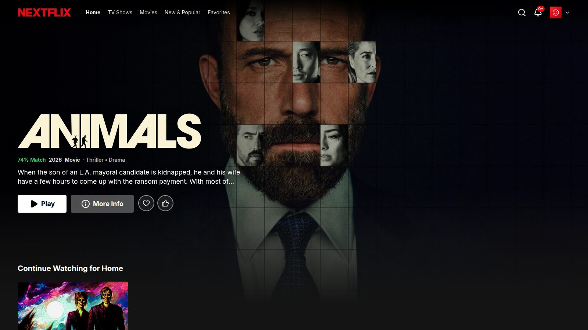</p>

Nextflix runs on one computer in your home and everyone on your Wi-Fi can use it. Titles, posters and trailers come
from [TMDB](https://www.themoviedb.org/); the video itself is streamed from torrents while it downloads, so there
is nothing to download or organize beforehand.

## What you get

### Feels like Netflix

A big billboard, your **Continue Watching** row, trending titles, the weekly **Top 10**, genre rows and
recommendations based on what you like. Movies, TV Shows and New & Popular each have their own page.

<p>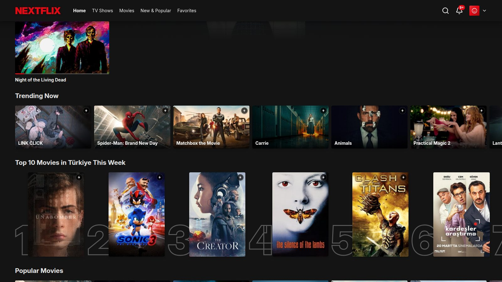</p>

### One click to watch

Open any title to see its trailer, cast and details. For series, pick a season and an episode. Press **Play** and
Nextflix finds the best available version for you, starts it within seconds and remembers where you stopped.

<p>
  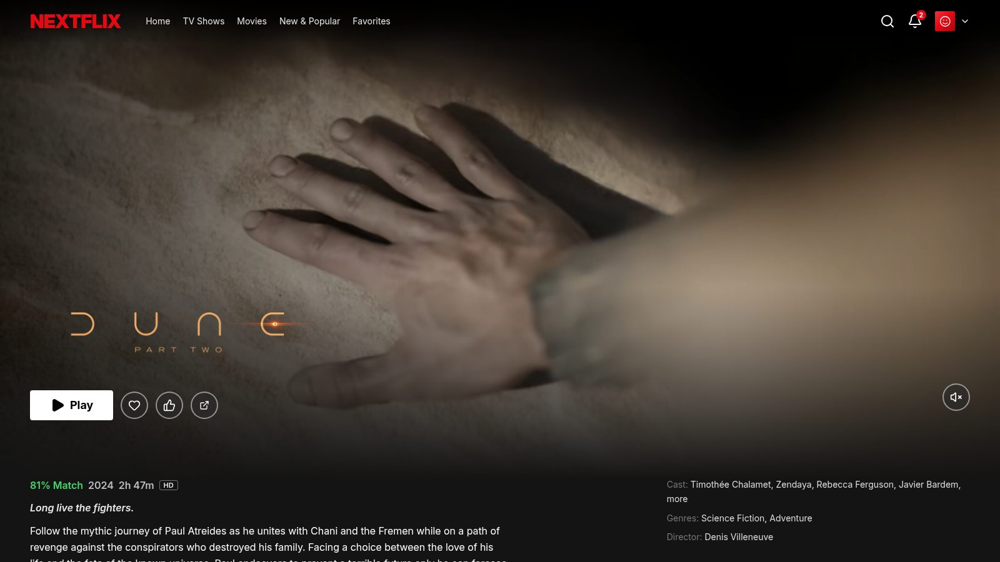
  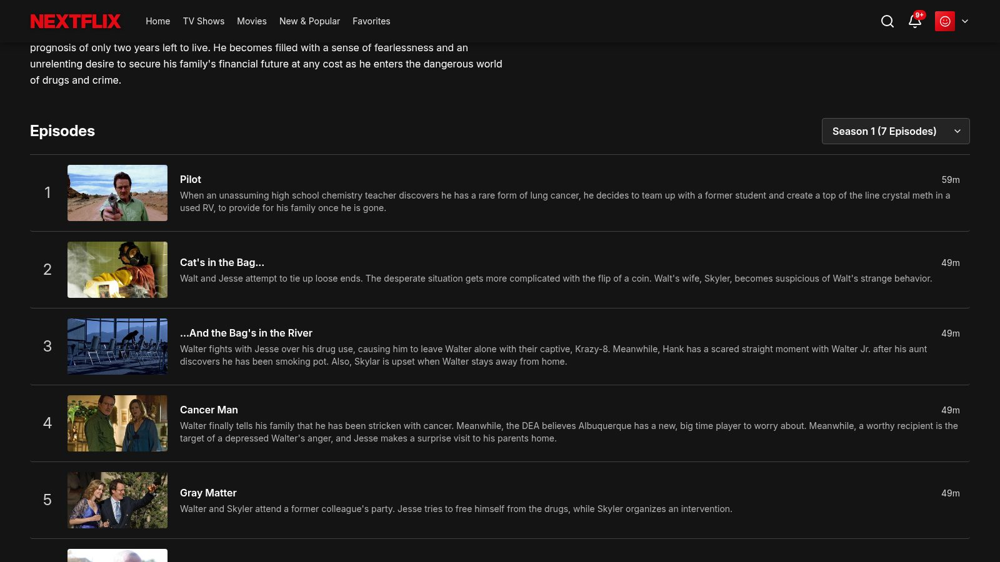
</p>

### Subtitles that just work

Subtitles are found automatically from several sources and lined up with the video, so they don't run early or
late. Choose the audio track and subtitle language right in the player, and change the subtitle size and style in
Settings. If no subtitle exists in your language, Nextflix can translate one with Claude AI (optional, uses your own
API key).

<p>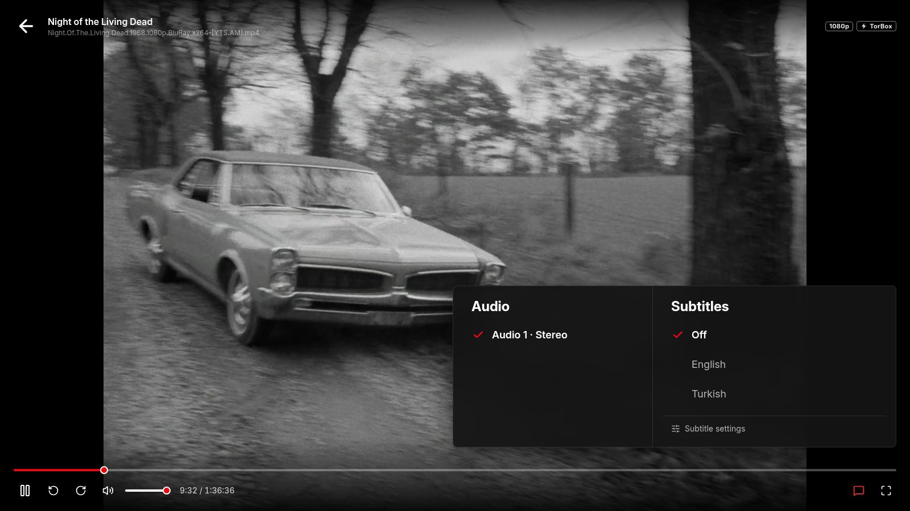</p>

### A player made for binge watching

- **Skip intro** and **Next episode** buttons, with an optional autoplay countdown.
- Seeking with preview thumbnails, ±10 second jumps and a pause screen.
- Picks up where you left off, on any device.
- Optional **Anime4K** upscaling in the browser that sharpens older and lower-resolution anime.

### Search that understands you

Search suggests titles as you type and still finds what you meant when there's a typo. Filter by movies or series
and combine genres like Anime + Sci-Fi.

<p>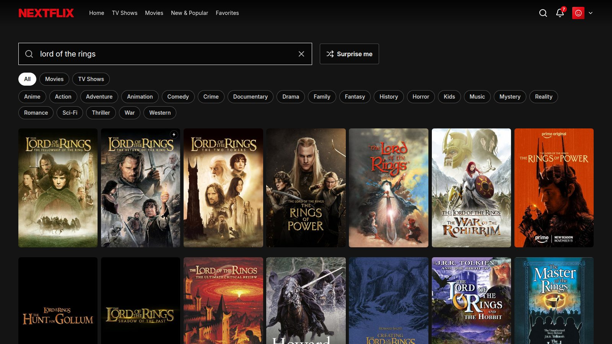</p>

### Can't decide? Surprise me

**Surprise me** picks something you'll probably enjoy, based on what you've watched and liked, and tells you why.
Not feeling it? Press **Something else**.

<p>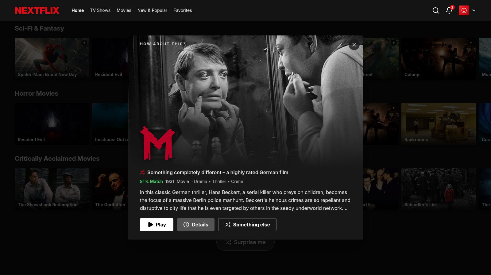</p>

### Profiles for the whole family

Up to 5 profiles, each with its own Continue Watching, Favorites, likes and recommendations. No passwords, just
pick your face. Each profile can use English or Turkish.

<p>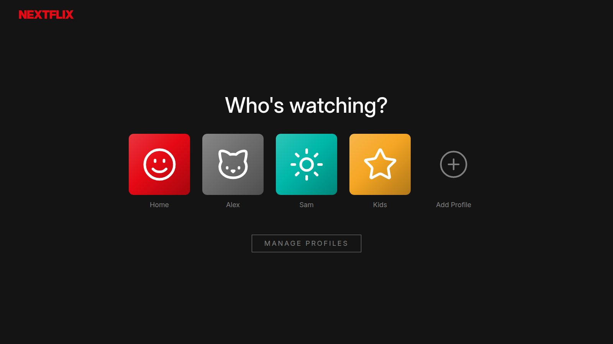</p>

### Never miss a release

The bell shows new episodes of series and movies that just came out or are coming soon.

<p>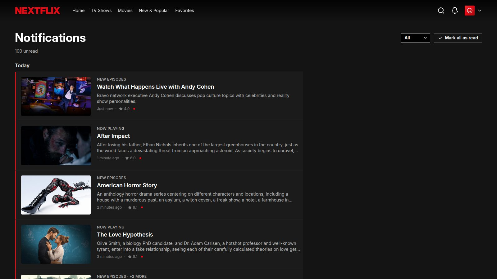</p>

### Your settings, your way

Each profile picks its display language, preferred audio and subtitle language, subtitle size and autoplay.
Advanced settings hold the indexer, the optional TorBox account, subtitle provider keys and AI translation.

<p>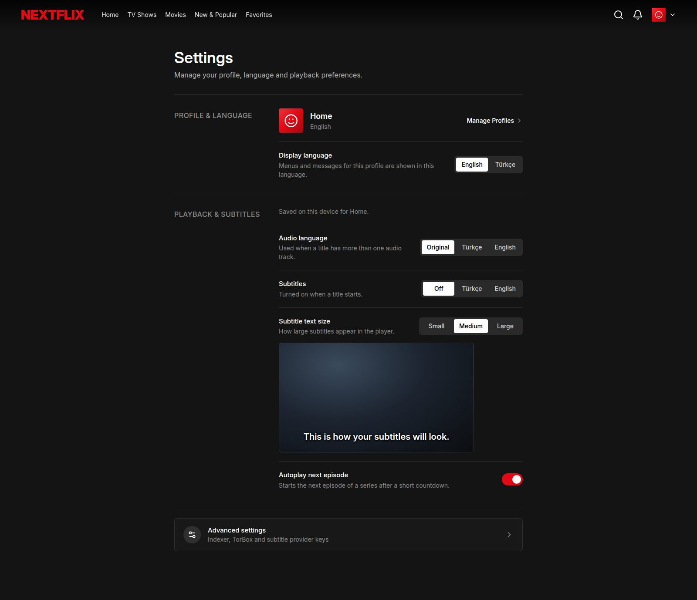</p>

## Watch on every screen

| Laptop and desktop | Phone and tablet | LG TV (webOS) | Android TV and Google TV |
|---|---|---|---|
| Open the web app in any modern browser. | The web app turns into a mobile layout with a bottom tab bar and touch controls. | A dedicated TV app made for the remote: arrow keys, on-screen keyboard, the same profiles and progress. | A native app with the same screens and remote controls, plus your Continue watching on the TV's home screen and voice search. |

<p>
  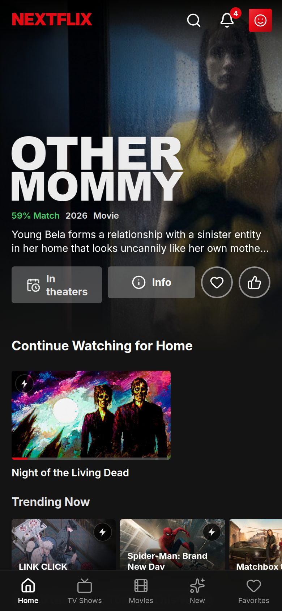
  &nbsp;
  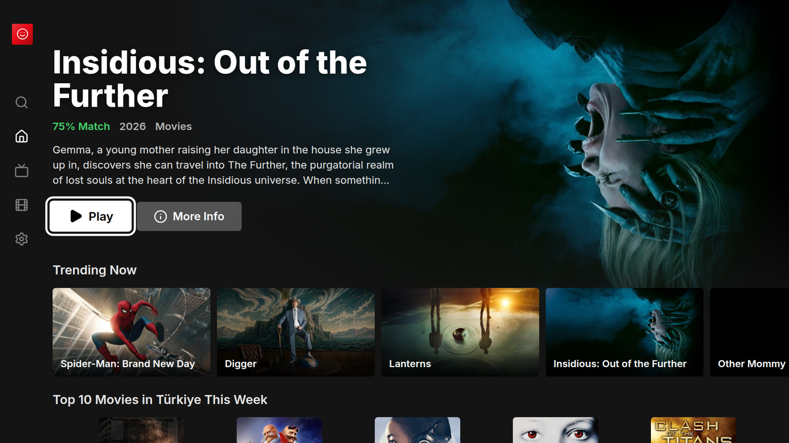
</p>

<p></p>

## Get started

You need a computer that stays on (Windows with WSL, Linux or a home server) with
[Docker](https://docs.docker.com/engine/install/) installed. Everything runs inside Docker containers, so nothing
else gets installed on your computer.

1. **Get a free TMDB token.** Create an account at [themoviedb.org](https://www.themoviedb.org/), request an API
   key and copy the long **API Read Access Token**. Step by step: [docs/tmdb-setup.md](docs/tmdb-setup.md).
2. **Add your settings.**
   ```bash
   cp deploy/config/server.env.example deploy/config/server.env
   cp deploy/config/web.env.example    deploy/config/web.env
   ```
   Open `deploy/config/server.env` and paste the token after `TMDB_API_KEY=`.
3. **Prepare the TV app.** With an LG TV, run `bash tv/webos/scripts/build.sh`. Without one,
   `mkdir -p tv/webos/dist` is enough.
4. **Start Nextflix.**
   ```bash
   docker compose -f deploy/docker-compose.yml up -d --build
   ```
5. **Add torrent sources.** Open Jackett at http://127.0.0.1:9117 on the same computer, add a few indexers and
   paste its API key into Nextflix under **Settings → Advanced → Indexer**. Details: [docs/jackett.md](docs/jackett.md).

Now open **http://nextflix.local** (or `http://<computer-ip>:3008`) on any device in your home.

- Updating: `git pull`, then run step 4 again. Your profiles and progress are kept.
- Installing the TV app on an LG TV: [tv/webos/README.md](tv/webos/README.md).
- Installing the Android TV / Google TV app: [tv/android/README.md](tv/android/README.md).
- Everything else (ports, backups, troubleshooting): [docs/DEPLOY.md](docs/DEPLOY.md).

### Titles have no artwork?

Some internet providers block TMDB through DNS. Turn on **DNS over HTTPS** on the computer running Nextflix
(Windows: Settings → Network → DNS server assignment → 1.1.1.1 / 1.0.0.1 with "Encrypted only (DNS over HTTPS)").
Other devices at home don't need any change: all artwork is served through Nextflix itself.

## Privacy and safety

- **Home network only.** Nextflix has no login, so never expose it to the internet. Only the app (ports 80 and
  3008) and its server (8252) are visible on your home network; the helper services are not.
- **Your data stays home.** Profiles, progress and settings are stored on your own computer.
- **Watch responsibly.** Nextflix streams whatever your indexers find. Make sure you are allowed to watch it where
  you live.

## For developers

Nextflix is a small modular monolith: one Go server, one Next.js web app, an LG webOS app, a native Android TV app
(`tv/android/`, built into an APK, not a container) and a few off-the-shelf containers. It was originally based on
[azad25/homeflix-wifi](https://github.com/azad25/homeflix-wifi) and has since been restructured and largely
rewritten.

| Container | What it does | Port |
|---|---|---|
| `server` | Go/gin API (`server/`), SQLite in the `db` volume, ffmpeg for remuxing | 8252 |
| `web` | Next.js app (`web/`), proxies `/api/*` to the server and `/tmdb-img/*` to TMDB | 3008, 80 |
| `tvapp` | Serves the built webOS app (`tv/webos/`) | internal |
| `mdns` | Announces `nextflix.local` on the LAN | 5353/udp |
| `redis` | Backs the notification feed | internal |
| `jackett` | Torrent indexer aggregator | 127.0.0.1:9117 |
| `flaresolverr` | Solves Cloudflare challenges for Jackett | internal |
| `torrserver` | Streams torrents over HTTP while they download | 127.0.0.1:8090, 41413 (peers) |

Start with [docs/ARCHITECTURE.md](docs/ARCHITECTURE.md) (module map, dependency rules, streaming and subtitle
internals) and [docs/API.md](docs/API.md) (endpoints).

Never run `go`, `npm` or `node` on the host. The check scripts compile inside throwaway containers with the source
mounted read-only (from Windows, call them through WSL):

```bash
wsl -d Ubuntu-24.04 -- bash /mnt/c/<path>/scripts/check-backend.sh    # prints GO_BUILD=ok|failed
wsl -d Ubuntu-24.04 -- bash /mnt/c/<path>/scripts/check-frontend.sh   # prints tsc output and TSC_EXIT=<n>
wsl -d Ubuntu-24.04 -- bash /mnt/c/<path>/scripts/tidy-backend.sh     # go mod tidy in a container
wsl -d Ubuntu-24.04 -- bash /mnt/c/<path>/tv/android/scripts/check.sh   # Android TV app, prints GRADLE_EXIT=<n>
```

`check-backend.sh` takes an optional package list and `check-frontend.sh` an optional regex that counts the type
errors in matching files (`OWN_ERRORS=<n>`). The web app never loads images from `image.tmdb.org` directly; keep
all artwork on the `/tmdb-img/t/p/<size><path>` proxy when adding UI. Never mount the Docker socket into any
container.
